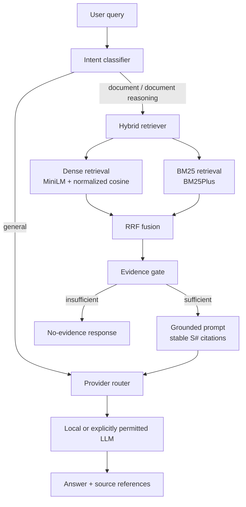

# Hybrid AI Orchestrator RAG

A local-first terminal chatbot that decides whether a question needs local
document evidence, retrieves that evidence with two different search methods,
fuses their rankings, and asks a configurable LLM to answer.

The project is intentionally small enough to inspect. It is useful for:

- asking questions over a personal or team document collection;
- keeping document embeddings and retrieval on the local machine;
- comparing semantic and lexical retrieval on the same corpus;
- experimenting with provider routing and explicit cloud/private modes;
- learning how a complete Dense + BM25 + RRF pipeline fits together without
  LangChain, LlamaIndex, or a vector database.

The project name is **Hybrid AI Orchestrator RAG**.

## Status

Implemented and tested:

- deterministic intent-aware routing;
- local document ingestion for `.txt`, `.md`, and `.pdf`;
- local sentence-transformer embeddings;
- BM25 lexical retrieval;
- Reciprocal Rank Fusion of Dense and BM25 results;
- independent evidence gates;
- local Ollama generation;
- optional OpenAI and Gemini providers with fallback;
- validated citation IDs and source metadata;
- local-only privacy mode and explicit cloud permissions;
- incremental index rebuilds.

Not implemented:

- web UI or HTTP API;
- OCR for scanned PDFs;
- streaming responses;
- a vector database or approximate nearest-neighbor index;
- cross-encoder reranking;
- multi-user authentication;
- persistent conversation history across runs;
- automated evaluation against a labeled benchmark.

---

## 1. Overview

A normal chatbot sends every question to an LLM. A document assistant sends
every question through retrieval. Both behaviors are wrong for a mixed
workload: general conversation does not need a document search, while a short
question such as “What is the refund period in my PDF?” definitely does.

Hybrid AI Orchestrator RAG separates two decisions:

1. **What kind of request is this?**
   General conversation, local-document lookup, or document reasoning.
2. **Which allowed LLM provider should answer it?**
   Local Ollama, or an explicitly permitted cloud provider.

For document requests, the application retrieves candidates with both Dense
semantic search and BM25 keyword search, combines their ranked lists with RRF,
checks whether the evidence is actually relevant, and only then calls the
selected LLM.

The design is local-first: document ingestion, embeddings, BM25, RRF, and the
index remain local. Cloud access is opt-in and separately gated for general
requests and document evidence. If the evidence is insufficient, the
application says so instead of forcing unrelated chunks into the prompt.

---

## 2. Key features

| Feature | Status | Notes |
|---|---|---|
| Intent-aware routing | Implemented | Rule-based document cues, reasoning cues, and document follow-ups. |
| Dense semantic retrieval | Implemented | `sentence-transformers`, normalized cosine similarity. |
| BM25 lexical retrieval | Implemented | `rank-bm25` `BM25Plus` with a shared tokenizer. |
| Reciprocal Rank Fusion | Implemented | Stable chunk IDs, one-based ranks, configurable `RRF_K`. |
| Local document ingestion | Implemented | Recursive `.txt`, `.md`, `.pdf`; PDF page metadata. |
| Incremental indexing | Implemented | SHA-256 file hashes; unchanged chunks and embeddings are reused. |
| Evidence relevance gates | Implemented | Separate Dense and BM25 thresholds; no blind top-k trust. |
| LLM answer generation | Implemented | Ollama, OpenAI Responses API, and Google Gemini. |
| Source references | Implemented | Stable `[S#]` IDs, citation validation, file/page display. |
| Local-only mode | Implemented | Cloud providers are removed from every chain. |
| Explicit cloud permissions | Implemented | Separate general and document-evidence gates. |
| Bounded in-session history | Implemented | In memory only; document history is not sent to a general cloud call. |
| Web UI / HTTP API | Not implemented | The interface is a terminal application. |
| OCR | Not implemented | Scanned PDFs need external OCR before ingestion. |
| Streaming | Not implemented | Provider calls return a complete answer. |
| Vector database | Not implemented | Retrieval uses NumPy over local embeddings. |

---

## 3. How the system works

```text
User query
  -> intent classification
  -> route selection
       -> general: provider chain, no retrieval
       -> document / document_reasoning:
            -> Dense retrieval + BM25 retrieval
            -> Reciprocal Rank Fusion
            -> evidence relevance gate
                 -> insufficient: explain the limitation, do not call an LLM
                 -> sufficient: build grounded prompt with [S#] evidence
            -> provider chain
            -> answer + validated source references
```

The boundaries are deliberate:

- **Intent classification** decides whether local documents are needed. It does
  not choose an LLM.
- **Provider routing** decides which configured provider may answer. It does not
  decide whether to retrieve.
- **Retrieval** returns ranked evidence. It does not generate prose.
- **Orchestration** combines the decisions, enforces privacy, maintains session
  history, and validates citation IDs.

General questions bypass retrieval. Document questions retrieve first. A short
document question is not treated as “easy” merely because it is short.

### Routing behavior

Routes currently implemented:

- `general`
- `document`
- `document_reasoning`

The classifier looks for explicit document references such as “my PDF,” “the
uploaded documents,” “the local knowledge base,” “the document says,” or a file
extension. It then checks for reasoning words such as compare, contrast, explain,
analyze, evaluate, why, or trade-off.

Examples:

| Question | Route | Reason |
|---|---|---|
| “What is the capital of France?” | `general` | No document cue. |
| “What is the refund policy in my PDF?” | `document` | Explicit document reference, even though the question is short. |
| “Compare the refund and warranty terms in my documents.” | `document_reasoning` | Document cue plus reasoning keyword. |
| “What does the document say about submarines?” | `document` | Retrieval is attempted; weak evidence is rejected. |
| “What about the exceptions?” after a document answer | `document` | Follow-up to the previous document-grounded turn. |
| “What is the deadline?” after a document answer | `document` | Short wh-question treated conservatively as a document follow-up. |

The router is deterministic, not an ML intent classifier. It does **not** use
prompt complexity alone to decide whether RAG is needed. If a query is
ambiguous and has no document history, the default is `general`; the reason is
visible in `--debug` output. After a document answer, short wh-questions and
pronoun-based follow-ups stay in document mode so the application does not
silently answer from general knowledge.

A general question after a document turn can still be asked explicitly, for
example “As a general question, explain the difference between TCP and UDP.”
The classifier does not treat that as a document question.

### Provider routing

Provider routing is separate from intent:

- `DEFAULT_PROVIDER` is preferred.
- `PROVIDER_PRIORITY` defines the fallback order.
- Cloud providers are filtered unless the applicable permission is enabled.
- A provider with a missing key or model is not registered.
- Local-only mode never includes a cloud provider, even if keys are configured.
- A remote Ollama endpoint is treated as external, not local.

---

## 4. Hybrid retrieval explained

### Dense retrieval

Dense retrieval embeds the question and every document chunk into the same
vector space, then ranks chunks by vector similarity. It can find passages that
share meaning even when they do not share exact words.

- Default model: `all-MiniLM-L6-v2`.
- Embeddings are generated locally.
- Vectors are L2-normalized.
- Ranking uses cosine similarity.
- Stored vectors are checked for the expected model and dimension.
- Changing the embedding model causes the index to be rebuilt.

Dense retrieval can miss exact identifiers, rare names, error codes, and short
keyword-heavy questions.

### BM25 retrieval

BM25 is a lexical ranking function. It rewards query terms that occur in a
chunk while accounting for term frequency, document frequency, and chunk
length. It is strong for names, identifiers, and exact phrases, but it does not
understand synonyms.

This implementation:

- uses `BM25Plus` from `rank-bm25`;
- uses the same Unicode-aware tokenizer for documents and queries;
- applies light plural normalization and a small English stopword list;
- returns only chunks with at least one query-term overlap;
- keeps BM25 scores separate from Dense scores.

### Reciprocal Rank Fusion

RRF combines two **ranked lists** without comparing their raw scores:

```text
RRF(d) = sum over retrievers r of 1 / (k_rrf + rank_r(d))
```

- `rank_r(d)` is the one-based rank of chunk `d` in retriever `r`.
- `k_rrf` is configurable with `RRF_K`; the default is 60.
- A chunk found by only one retriever still receives that retriever’s term.
- A chunk found by both receives both terms.
- Results are deduplicated by stable `chunk_id`.
- Ties are broken deterministically.

RRF is used because a cosine similarity and a BM25 score are not on the same
scale. Adding them directly would make one method dominate for reasons unrelated
to relevance. RRF uses only rank positions, which is stable across scoring
methods.

Combining Dense and BM25 can improve coverage, but it does not guarantee a
correct answer. The evidence gates and the grounded prompt are additional
layers, not a correctness proof.

---

## 5. Architecture



Actual project structure:

```text
.
├── app.py
├── config.py
├── .env.example
├── .gitattributes
├── .gitignore
├── README.md
├── NOTICE.md
├── pytest.ini
├── requirements.txt
├── requirements-dev.txt
├── data/
│   └── documents/
│       ├── .gitkeep
│       └── sample_policy.md
├── docs/
│   └── ARCHITECTURE.md
├── src/
│   ├── router/
│   │   ├── classifier.py
│   │   └── router.py
│   ├── rag/
│   │   ├── ingestion.py
│   │   ├── chunker.py
│   │   ├── embeddings.py
│   │   ├── dense_retriever.py
│   │   ├── bm25_retriever.py
│   │   ├── fusion.py
│   │   ├── citations.py
│   │   ├── pipeline.py
│   │   ├── index.py
│   │   └── types.py
│   ├── llm/
│   │   ├── base.py
│   │   ├── factory.py
│   │   ├── ollama_provider.py
│   │   ├── openai_provider.py
│   │   └── gemini_provider.py
│   └── orchestration/
│       ├── intent.py
│       └── orchestrator.py
├── storage/
│   └── .gitkeep
└── tests/
```

Important module responsibilities:

| Module | Responsibility |
|---|---|
| `app.py` | CLI parsing, index lifecycle commands, interactive loop, status/help output, error presentation. |
| `config.py` | Environment parsing, defaults, validation, privacy/provider rules, path resolution. |
| `src/router/classifier.py` | Deterministic document/general/reasoning classification. |
| `src/router/router.py` | Provider chain construction, fallback, cloud filtering, cloud disclosure callback. |
| `src/orchestration/intent.py` | Session-aware follow-up decisions. |
| `src/orchestration/orchestrator.py` | End-to-end route/retrieve/generate flow, history, citations, evidence refusal. |
| `src/rag/ingestion.py` | Recursive document discovery, text extraction, PDF pages, per-file errors. |
| `src/rag/chunker.py` | Overlapping character chunks and stable chunk IDs. |
| `src/rag/embeddings.py` | Lazy local SentenceTransformer loading and normalized encoding. |
| `src/rag/dense_retriever.py` | Cosine ranking over persisted embeddings. |
| `src/rag/bm25_retriever.py` | BM25Plus index, tokenizer, query coverage. |
| `src/rag/fusion.py` | RRF calculation, deduplication, deterministic ordering. |
| `src/rag/citations.py` | Evidence formatting, `[S#]` mapping, citation validation, source display. |
| `src/rag/pipeline.py` | Dense + BM25 execution and evidence gating. |
| `src/rag/index.py` | JSON/NPY persistence, manifest, incremental rebuilds. |
| `src/llm/*` | Common provider contract and provider-specific implementations. |

The index is not committed. `storage/` is generated locally.

---

## 6. Prerequisites

- **Python 3.12 or newer.** The pinned NumPy release requires Python 3.12+.
  Verification was performed with Python 3.13.15.
- **Git**, for cloning the repository.
- **Ollama** for the default local generation mode.
  - The default model is `qwen3:1.7b`.
  - The model must be installed separately with Ollama.
  - In local-only mode, `OLLAMA_HOST` must be a loopback address
    (`localhost`, `127.0.0.1`, or `::1`).
- **Internet access during first setup**:
  - to install Python packages;
  - to download `all-MiniLM-L6-v2` on the first embedding run;
  - to obtain the Ollama model if it is not already installed.
- **Optional cloud credentials** for OpenAI and/or Gemini. Cloud access is not
  required for local-only mode.
- **Hardware**: no benchmark was run. The local embedding stack includes
  PyTorch and `sentence-transformers`; the first model load can be slow and may
  use significant memory. CPU-only operation is possible but slower. Ollama may
  use CPU or GPU depending on the local installation.
- **Disk**: model caches, the local Python environment, and the generated index
  require additional space. The exact size depends on the selected models.

---

## 7. Installation from a clean machine

### Windows PowerShell

```powershell
git clone https://github.com/minhbuisieucap/hybrid-ai-orchestrator-rag.git
cd hybrid-ai-orchestrator-rag

py -3.12 -m venv .venv
.\.venv\Scripts\Activate.ps1
python -m pip install --upgrade pip
python -m pip install -r requirements.txt

# Optional: copy configuration defaults.
Copy-Item .env.example .env

# Install the default local model in Ollama.
# Run this once, after Ollama is installed.
ollama pull qwen3:1.7b

# Verify the CLI.
python app.py --help

# Build the local index from data/documents/.
python app.py --ingest
```

If PowerShell blocks activation, create a process-local policy exception:

```powershell
Set-ExecutionPolicy -Scope Process -ExecutionPolicy Bypass
.\.venv\Scripts\Activate.ps1
```

### Linux/macOS

```bash
git clone https://github.com/minhbuisieucap/hybrid-ai-orchestrator-rag.git
cd hybrid-ai-orchestrator-rag

python3 -m venv .venv
source .venv/bin/activate
python -m pip install --upgrade pip
python -m pip install -r requirements.txt

cp .env.example .env
ollama pull qwen3:1.7b
python app.py --help
python app.py --ingest
```

The first `--ingest` may download the embedding model. After the model is
cached, embedding inference is local.

The included `data/documents/sample_policy.md` is fictional. Replace it with
your own documents or remove it before building a real index.

For development:

```powershell
python -m pip install -r requirements-dev.txt
python -m pytest
python -m ruff check app.py config.py src tests
```

---

## 8. Configuration reference

All settings are optional except that local generation requires a usable Ollama
model. Copy `.env.example` to `.env` or set environment variables directly. The
application validates values at startup.

`REQUIRED` below means required for the indicated feature, not necessarily
required to start the application.

| Variable | Purpose | Default | Required? | Example |
|---|---|---|---|---|
| `DOCUMENTS_DIR` | Directory scanned for source files. | `data/documents` | No | `data/documents` |
| `STORAGE_DIR` | Local index directory. | `storage` | No | `storage` |
| `EMBEDDING_MODEL` | Local SentenceTransformer model. | `all-MiniLM-L6-v2` | No | `all-MiniLM-L6-v2` |
| `EMBEDDING_BATCH_SIZE` | Embedding batch size. | `32` | No | `32` |
| `CHUNK_SIZE` | Character window size. | `800` | No | `800` |
| `CHUNK_OVERLAP` | Character overlap; must be smaller than chunk size. | `120` | No | `120` |
| `DENSE_TOP_K` | Dense candidates per query. | `8` | No | `8` |
| `BM25_TOP_K` | BM25 candidates per query. | `8` | No | `8` |
| `FUSED_TOP_K` | Final RRF candidates. | `5` | No | `5` |
| `RRF_K` | RRF constant. | `60` | No | `60` |
| `DENSE_MIN_SIMILARITY` | Dense cosine evidence gate. | `0.30` | No | `0.30` |
| `BM25_MIN_SCORE` | Raw BM25 evidence gate. | `0.0` | No | `0.0` |
| `BM25_MIN_COVERAGE` | Content-token coverage gate for BM25. | `0.67` | No | `0.67` |
| `MAX_CONTEXT_CHARS` | Maximum evidence characters shown to the LLM. | `6000` | No | `6000` |
| `LOCAL_ONLY` | Master privacy switch. | `true` | No | `true` |
| `ALLOW_CLOUD_FALLBACK` | Permit cloud providers in general chains. | `false` | No | `false` |
| `ALLOW_CLOUD_RAG` | Permit cloud providers for document evidence. Requires `ALLOW_CLOUD_FALLBACK=true`. | `false` | No | `false` |
| `DEFAULT_PROVIDER` | Preferred provider name. | `ollama` | No | `ollama` |
| `PROVIDER_PRIORITY` | Comma-separated provider fallback order. | `ollama,openai,gemini` | No | `ollama,openai,gemini` |
| `OLLAMA_HOST` | Ollama HTTP endpoint. Local-only requires loopback. | `http://localhost:11434` | For local mode | `http://localhost:11434` |
| `OLLAMA_MODEL` | Local Ollama model. | `qwen3:1.7b` | For local mode | `qwen3:1.7b` |
| `OPENAI_API_KEY` | OpenAI credential. | empty | Only for OpenAI | leave blank locally |
| `OPENAI_MODEL` | OpenAI model name available to your account. | empty | Only for OpenAI | your-model-name |
| `GEMINI_API_KEY` | Gemini credential. | empty | Only for Gemini | leave blank locally |
| `GEMINI_MODEL` | Gemini model name available to your account. | empty | Only for Gemini | your-model-name |
| `REQUEST_TIMEOUT_SECONDS` | Provider HTTP timeout. | `60` | No | `60` |
| `LLM_TEMPERATURE` | General-chat temperature; RAG uses `0.0`. | `0.2` | No | `0.2` |
| `HISTORY_MESSAGES` | Bounded in-session history entries. | `6` | No | `6` |

Invalid values are rejected, including:

- `CHUNK_OVERLAP >= CHUNK_SIZE`;
- non-positive top-k or RRF values;
- a default provider missing from `PROVIDER_PRIORITY`;
- unknown provider names;
- `LOCAL_ONLY=true` with cloud permissions;
- `LOCAL_ONLY=true` with a non-loopback Ollama host;
- `ALLOW_CLOUD_RAG=true` without `ALLOW_CLOUD_FALLBACK=true`.

### Dense and BM25 thresholds

Dense cosine scores and BM25 scores are not comparable. They have separate
gates. The defaults are conservative starting points; calibrate them against
your own documents and use `--debug` to inspect retrieved scores and ranks.

If the gates are too strict, relevant evidence is rejected. If they are too
loose, unrelated chunks can reach the model. This is a corpus-specific tuning
decision.

### Provider selection

Provider order is:

1. `DEFAULT_PROVIDER`
2. the remaining names in `PROVIDER_PRIORITY`

A provider with no configured key/model is skipped. Cloud providers are
excluded entirely unless the relevant permissions are enabled.

---

## 9. How to use the application

### Start the interactive chatbot

```powershell
python app.py
```

The startup banner shows:

- privacy mode;
- whether cloud document evidence is enabled;
- configured providers;
- active provider chains for general and document requests;
- index status;
- configured document directory.

Commands:

```text
/help
/status
/ingest
/rebuild
/debug
/exit
```

### Ask a general question

```text
You: What is the difference between a process and a thread?
```

This should route to `general`, skip retrieval, and use an allowed LLM provider.
In local-only mode, that provider must be Ollama.

### Add documents

Place `.txt`, `.md`, or `.pdf` files in `data/documents/` or the directory set by
`DOCUMENTS_DIR`.

Then build or update the index:

```powershell
python app.py --ingest
```

The command:

- discovers supported files recursively;
- extracts text;
- creates overlapping chunks;
- reuses unchanged file embeddings;
- re-embeds changed files;
- removes chunks for deleted files;
- writes `storage/chunks.json`, `storage/embeddings.npy`, and
  `storage/manifest.json`.

Force a full rebuild when you want to reprocess every document:

```powershell
python app.py --rebuild-index
```

### Ask a document question

```text
You: What does the refund policy in my PDF say?
```

The expected flow is:

1. route to `document`;
2. embed the query and run Dense retrieval;
3. run BM25 retrieval;
4. fuse ranks with RRF;
5. reject weak evidence before generation;
6. build a grounded prompt with `[S1]`, `[S2]`, ...;
7. call the provider allowed for document tasks;
8. print the answer and the authoritative source list.

### Inspect sources

A document answer prints a source block similar to:

```text
Sources:
  [S1] sample_policy.md (cited)
  [S2] sample_policy.md (retrieved)
```

`cited` means the model referenced that evidence ID and the ID was validated.
`retrieved` means the chunk was supplied as evidence but the model did not cite
that specific chunk. The application never invents a source path or page
number; those values come from chunk metadata.

### One-shot query

```powershell
python app.py --ask "What does the warranty policy in my documents say?"
```

### Local-only mode

```powershell
python app.py --local-only
```

This overrides environment cloud settings. It is the safest mode for private
documents. If Ollama is unavailable, the application reports the problem and
does not contact a cloud provider.

### Enable cloud for general questions

Set:

```dotenv
LOCAL_ONLY=false
ALLOW_CLOUD_FALLBACK=true
```

Configure a provider and model your account can use:

```dotenv
OPENAI_API_KEY=
OPENAI_MODEL=
```

### Enable cloud for document evidence

This is a separate, explicit decision:

```dotenv
LOCAL_ONLY=false
ALLOW_CLOUD_FALLBACK=true
ALLOW_CLOUD_RAG=true
```

Or use the explicit CLI override:

```powershell
python app.py --allow-cloud-rag
```

Before a cloud document call, the application prints a visible disclosure.
General cloud requests do not include previous document-grounded history.

### Example output format

The following is an illustrative format, not a live transcript:

```text
[route=document] [privacy=local]
[provider=ollama:qwen3:1.7b]
[Document answer (grounded in local evidence)]
Customers may request a refund within 30 calendar days. [S1]

Sources:
  [S1] sample_policy.md (cited)
```

---

## 10. Illustrative Hybrid RAG example

This example is intentionally artificial. It is not a benchmark result.

Suppose two retrievers return these ranks for a query:

| Chunk | Dense rank | BM25 rank |
|---|---:|---:|
| A | 1 | 3 |
| B | 2 | 1 |
| C | — | 2 |

With `RRF_K = 60`:

```text
A = 1/(60+1) + 1/(60+3)
B = 1/(60+2) + 1/(60+1)
C = 1/(60+2)
```

The fused order is determined by those values, not by adding a cosine score to
a BM25 score. A chunk found by only one method can still be selected, which is
why missing ranks are handled explicitly.

The actual implementation runs Dense and BM25 for the same query, deduplicates
by `chunk_id`, preserves Dense/BM25 ranks and scores for debugging, and applies
evidence gates before generation.

---

## 11. Testing and verification

Run the full suite:

```powershell
.\.venv\Scripts\python.exe -m pytest
```

Run the static check used during the audit:

```powershell
.\.venv\Scripts\python.exe -m ruff check app.py config.py src tests
```

Check dependency consistency:

```powershell
.\.venv\Scripts\python.exe -m pip check
```

Syntax-check all Python files:

```powershell
.\.venv\Scripts\python.exe -m compileall -q app.py config.py src tests
```

Latest observed result in this environment:

- Python 3.13.15
- **86 passed**, 0 failed, in pytest
- Ruff: all checks passed
- `pip check`: no broken requirements
- `compileall`: passed
- Real local index built from the sample document: 2 chunks
- Real Dense + BM25 + RRF retrieval checked for refund, warranty, shipping, and
  no-evidence queries
- Full orchestration checked with a fake LLM provider
- Real Ollama, OpenAI, and Gemini generation were **not** run because no live
  provider credentials or local Ollama service were available in the verification
  environment

The test suite covers:

- routing and follow-up intent;
- Dense retrieval shape, cosine scoring, and deterministic ties;
- BM25 ranking, tokenization, and empty-content corpora;
- RRF exact values, deduplication, missing ranks, and tie ordering;
- retrieval evidence rejection;
- chunking and page metadata;
- ingestion of valid, empty, and malformed documents;
- incremental indexing, changed/removed files, and embedding-model changes;
- citation validation and invalid-ID removal;
- local-only cloud blocking;
- provider fallback and cloud disclosure;
- configuration validation.

No CI workflow is currently configured. The result above is a local execution,
not a GitHub Actions status.

---

## 12. Troubleshooting

### Python version or dependency errors

This project requires Python 3.12+. Upgrade the interpreter, recreate the
virtual environment, and reinstall:

```powershell
py -3.12 -m venv .venv
.\.venv\Scripts\Activate.ps1
python -m pip install -r requirements.txt
```

### Ollama unavailable

Start Ollama and verify the model:

```powershell
ollama list
ollama pull qwen3:1.7b
```

In local-only mode the application will not silently use a cloud provider.

### Remote Ollama host rejected

Local-only mode accepts only `localhost`, `127.0.0.1`, or `::1` for
`OLLAMA_HOST`. A remote endpoint is treated as external and requires cloud
permissions. This is intentional: an Ollama endpoint on another machine is not
local for privacy purposes.

### Missing cloud credentials

A cloud provider is registered only when both its API key and model are
configured. Missing credentials do not make local-only mode fail. If cloud
fallback was expected, set the key, model, and explicit permission flags.

### Embedding model download failure

The first embedding run needs network access to fetch
`all-MiniLM-L6-v2`. Check connectivity, the model name, and available disk
space. After caching, inference is local.

### Index out of date or incompatible

After adding, changing, or removing documents:

```powershell
python app.py --ingest
```

After changing `EMBEDDING_MODEL` or chunk settings, rebuild:

```powershell
python app.py --rebuild-index
```

### Unsupported or empty documents

Supported extensions are `.txt`, `.md`, and `.pdf`. Empty or unreadable files
produce warnings and do not stop other documents. Scanned PDFs are not OCRed.

### No relevant evidence

The evidence gates rejected the retrieved chunks. Try a more specific question,
add relevant documents, rebuild the index, or calibrate
`DENSE_MIN_SIMILARITY`, `BM25_MIN_SCORE`, and `BM25_MIN_COVERAGE` using
`--debug`.

### Git authentication or push rejection

This is a maintainer concern, not normal application use. Authenticate through
Git Credential Manager or GitHub CLI on the local machine; do not paste a token
into chat or source files. If a normal non-force push is rejected because the
remote has new commits, fetch and reconcile the histories before pushing. Do
not use `git push --force`.

---

## 13. Privacy and security

### Local operations

The following remain local:

- document discovery and text extraction;
- chunking;
- sentence-transformer embedding inference;
- embedding persistence;
- BM25 indexing and retrieval;
- Dense retrieval;
- RRF fusion;
- evidence gating;
- the local index in `storage/`.

### Network operations

- The first package installation uses the Python package index.
- The first embedding run may download `all-MiniLM-L6-v2`.
- Ollama model downloads occur when a model is pulled.
- If a cloud provider is enabled, prompts and applicable context are sent to
  that provider.
- A remote Ollama host is treated as external by the privacy model.

### What local-only mode guarantees

With `LOCAL_ONLY=true`:

- cloud providers are filtered out of every provider chain;
- cloud fallback is not available;
- `OLLAMA_HOST` must be loopback;
- no document chunks or retrieval text are sent to OpenAI or Gemini;
- missing local service produces an error rather than a cloud fallback.

Bugs or misconfiguration can still defeat privacy guarantees. Verify `.env`,
environment variables, and the startup banner before processing sensitive data.

### API keys and Git

- Keys are read from environment variables or `.env`.
- `.env` is Git-ignored.
- `.env.example` contains placeholders only.
- The `Settings` object marks key fields as non-repr.
- The application does not print API keys.
- `.gitignore` excludes virtual environments, generated indexes, local documents,
  caches, and `.env`.

### Remaining privacy limitations

- The index and chunk text are stored in plaintext locally. Use operating-system
  permissions and disk encryption if needed.
- Conversation history is in memory for the current process only.
- Cloud providers may retain data under their own policies; this project cannot
  control that.
- General cloud requests exclude previous document-grounded history, but a user
  can still type document content directly into a general question.
- Local document text can contain prompt-injection instructions. The prompt
  treats evidence as untrusted data, but no LLM implementation can guarantee
  immunity.
- There is no authentication or multi-user isolation. Do not expose this CLI as
  a shared service without adding security controls.

---

## 14. Limitations and roadmap

### Current limitations

- Terminal interface only.
- No OCR; PDF text extraction only.
- Fixed character chunks can split sentences and tables.
- Brute-force NumPy Dense search and in-memory BM25 are intended for small local
  corpora.
- No vector database, approximate nearest-neighbor index, or cross-encoder
  reranker.
- In-session history only; no transcript persistence.
- No streaming.
- No authentication, authorization, or rate limiting.
- Relevance thresholds are conservative defaults, not calibrated for every
  corpus.
- Cloud provider code paths were not live-tested.
- The local model’s answer quality and citation compliance depend on the model.
- Citation IDs are validated; arbitrary factual claims, quotations, or page
  numbers in model prose are not semantically verified.
- The upstream repositories had no visible license at the time of inspection.

### Possible future work

These are proposals, not implemented features:

- an HTTP API or web UI with authentication and output escaping;
- OCR ingestion for scanned PDFs;
- structure-aware or sentence-aware chunking;
- cross-encoder reranking after RRF;
- optional vector indexing for larger corpora;
- streaming responses;
- a labeled retrieval/answer evaluation set;
- token and cost accounting;
- an audited license and contribution process.

---

## 15. License, attribution, and contribution

This project is an independent implementation informed by:

- [Multi-Model Chatbot Router](https://github.com/miahoanghoang/chatbot-with-auto-router)
- [Local RAG Assistant](https://github.com/miahoanghoang/local-rag)

At inspection time, both upstream repositories had no `LICENSE` file in their
complete trees. This repository also does not currently declare a license. No
upstream source is vendored or copied verbatim.

See [NOTICE.md](NOTICE.md) for attribution and the unresolved licensing status.
Do not assume permission to redistribute this project or an upstream derivative
until the licensing situation is clarified. This is not legal advice.

Contribution process: not established yet. A contribution workflow should be
defined only after the project owners confirm a license and review policy.

---

## Quick command summary

```powershell
# Install
python -m venv .venv
.\.venv\Scripts\Activate.ps1
python -m pip install -r requirements.txt

# Local model (if using the default Ollama setup)
ollama pull qwen3:1.7b

# Index documents
python app.py --ingest

# Chat
python app.py

# One-shot
python app.py --ask "What does the policy in my documents say?"

# Rebuild
python app.py --rebuild-index

# Development
python -m pytest
python -m ruff check app.py config.py src tests
```
